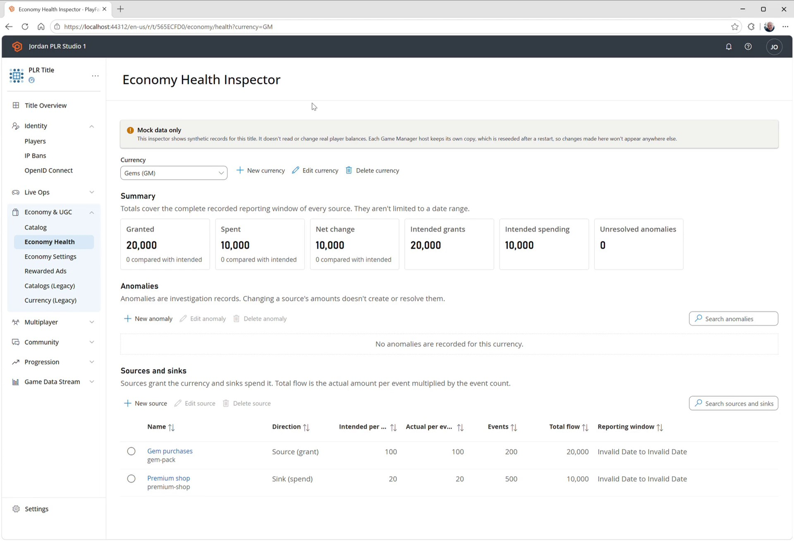
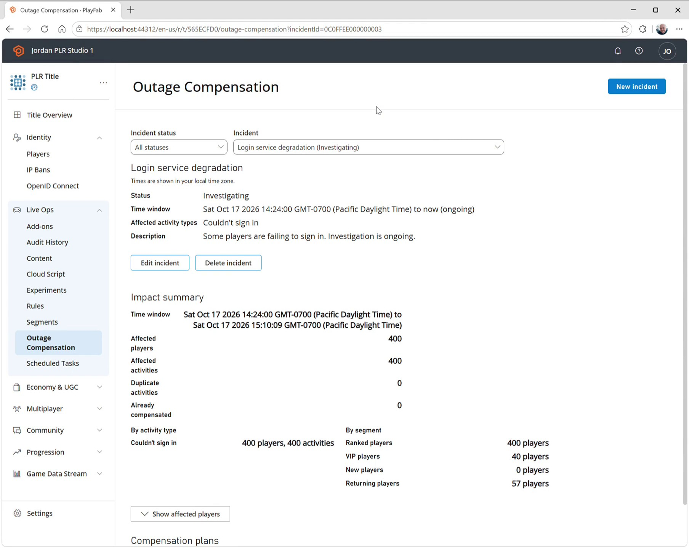

# Game Manager AI New Page Agent

Hi everyone! Do you know how to write services in C# but don't feel excited about making the UI in React?


There's an AI agent for that. It's called **GM New Page** agent and it scaffolds and builds Game Manager pages for you.

# Preview

I came up with two scenarios for the New Page Agent to work on. I think these are great feature ideas. Luckily David Sayed sits only fifty feet from me.

These videos you're seeing are one-shot passes from the agent.

## Economy health status

- **Premise:** Understand where currency enters and leaves the game, and investigate unusual changes.
- **Pages needed:** Currency selector, source/sink summaries, anomaly table, and grant-source details.
- **Sample customer benefit:** Discover a daily reward is granting **10× the intended currency** and identify the affected population.
- [C# service code](https://microsoft.visualstudio.com/PlayFab/_git/pf-main/commit/69c17e56ff8821778c4d7783af9c7cb7ef567b62?refName=refs%2Fheads%2Fjoroher%2Fgm-ai-economy-v2-health)
- [React UI code](https://microsoft.visualstudio.com/PlayFab/_git/pf-main/commit/8ad8f879963bae65bd22557ead6b84cd1117e331?refName=refs%2Fheads%2Fjoroher%2Fgm-ai-economy-v2-health)
- [Watch demo video](./media/economy-health-inspector.mp4)



## Outage compensation

- **Premise:** Find players affected by a disruption and prepare an appropriate make-good reward. Combines player activity, segments, and inventory.
- **Pages needed:** Incident selector, affected-player summary, reward form, preview, and confirmation dialog.
- **Sample customer benefit:** “Who lost a ranked match during the outage?” → **Preview compensation for 1,284 players**, with duplicate recipients excluded.
- [C# service code](https://microsoft.visualstudio.com/PlayFab/_git/pf-main/commit/5f92f8d5bc2c67467c13b3bf7d6163da81d37d64?refName=refs%2Fheads%2Fjoroher%2Fgm-ai-outage-compensation)
- [React UI code](https://microsoft.visualstudio.com/PlayFab/_git/pf-main/commit/725c4bbe130875134f9a399bc4e982f0ec72caad?refName=refs%2Fheads%2Fjoroher%2Fgm-ai-outage-compensation)
- [Watch demo video](./media/outage-compensation.mp4)



# How it works

## Working or mocked service

``` cs
// Copyright (C) Microsoft Corporation. All rights reserved.
namespace PlayFab.Services.EconomyHealth
{
    using PlayFab.WebAPIModels.EconomyHealth;
    using Utility;

    public interface IEconomyHealthService
    {
        ListEconomyHealthCurrenciesResponse ListCurrencies(ulong titleId);
        ErrorOrResult<EconomyHealthCurrencyResponse> GetCurrency(ulong titleId, string currencyCode);
        ErrorOrResult<EconomyHealthCurrencyResponse> CreateCurrency(ulong titleId, EconomyHealthCurrency currency);
        ErrorOrResult<EconomyHealthCurrencyResponse> UpdateCurrency(ulong titleId, EconomyHealthCurrency currency);
        ErrorOrResult<DeleteEconomyHealthResponse> DeleteCurrency(ulong titleId, string currencyCode);
        ErrorOrResult<ListEconomyHealthSourcesResponse> ListSources(ulong titleId, string currencyCode);
        ErrorOrResult<EconomyHealthSourceResponse> GetSource(ulong titleId, string sourceId);
        ErrorOrResult<EconomyHealthSourceResponse> CreateSource(ulong titleId, EconomyHealthSource source);
        ErrorOrResult<EconomyHealthSourceResponse> UpdateSource(ulong titleId, EconomyHealthSource source);
        ErrorOrResult<DeleteEconomyHealthResponse> DeleteSource(ulong titleId, string sourceId);
        ErrorOrResult<ListEconomyHealthAnomaliesResponse> ListAnomalies(ulong titleId, string currencyCode);
        ErrorOrResult<EconomyHealthAnomalyResponse> GetAnomaly(ulong titleId, string anomalyId);
        ErrorOrResult<EconomyHealthAnomalyResponse> CreateAnomaly(ulong titleId, EconomyHealthAnomaly anomaly);
        ErrorOrResult<EconomyHealthAnomalyResponse> UpdateAnomaly(ulong titleId, EconomyHealthAnomaly anomaly);
        ErrorOrResult<DeleteEconomyHealthResponse> DeleteAnomaly(ulong titleId, string anomalyId);
        ErrorOrResult<EconomyHealthSummaryResponse> GetSummary(ulong titleId, string currencyCode);
    }
}
```

## Describe the pages you want

Set the agent to:
- **Model:** Claude Opus 5.5 or GPT-6.1 Sol (or equivalent)
- **Reasoning:** High
- **Context window:** Default

This agent should build the first couple pages.

You can describe the pages you need however you like. But you can also have your AI look at your backend code and generate UI prompts from that, e.g.

> Write a prompt to be used by the "GM New Page" agent to build a UI to act as the outage compensation planner. It should be able to exercise all the APIs you created. Write it tailored to the agent as though you were a backend software developer who wrote the service and needs to make a nice UI for the user to interact with and manage it.

As you need to fix things, I recommend using a new session and whatever model and reasoning level you like.

## Get interviewed

Make sure to pay attention at the part where it asks if support staff should have the read permission. They should have it!

<blockquote>
<dl>
<dt><strong>AGENT:</strong> How should the feature be split into pages?</dt>
<dd><strong>HUMAN:</strong> (Accepted recommended) A landing page for the inspector, a details page for sources and one for anomalies, separate create/edit pages for sources and anomalies, and a dialog for creating and editing currencies.</dd>

<dt><strong>AGENT:</strong> I'll add new permissions for this. Should there be a separate read and write permission?</dt>
<dd><strong>HUMAN:</strong> (Accepted recommended) Yes, a new pair: Economy_HealthInspector_Read and Economy_HealthInspector_Write.</dd>

<dt><strong>AGENT:</strong> Should PlayFab's internal support roles get access?</dt>
<dd><strong>HUMAN:</strong> (Accepted recommended) Add Read to the read-only support role only.</dd>

<dt><strong>AGENT:</strong> Does this ship on for everyone, or behind a title flight first?</dt>
<dd><strong>HUMAN:</strong> (Accepted recommended) Behind a new title flight, EconomyHealthInspector, checked on the page and in every controller action.</dd>

<dt><strong>AGENT:</strong> What should the URLs look like?</dt>
<dd><strong>HUMAN:</strong> (Accepted recommended) economy/health?currency=GO for the landing page, with sources/{id}/view and /edit for sources, and the same shape for anomalies.</dd>

<dt><strong>AGENT:</strong> How should the page appear in navigation?</dt>
<dd><strong>HUMAN:</strong> (Accepted recommended) A visible left-nav item, with hidden child entries so the breadcrumbs work.</dd>

<dt><strong>AGENT:</strong> How does a user get from a table row to more detail, and where do actions live?</dt>
<dd><strong>HUMAN:</strong> (Accepted recommended) Single-select tables; the name links to the details page, and a command bar holds New, Edit, and Delete.</dd>

<dt><strong>AGENT:</strong> Should the tables be sortable or searchable?</dt>
<dd><strong>HUMAN:</strong> Yes, sortable columns plus a local search box. (You chose this instead of my "no sorting" default.)</dd>

<dt><strong>AGENT:</strong> What happens if the user leaves a form with unsaved changes?</dt>
<dd><strong>HUMAN:</strong> (Accepted recommended) Use Game Manager's existing "discard changes?" prompt.</dd>

<dt><strong>AGENT:</strong> What happens after a successful save, cancel, or delete?</dt>
<dd><strong>HUMAN:</strong> (Accepted recommended) Save goes to the record's details page with a success banner; Cancel returns to where the user came from; Delete returns to the landing page on the same currency with a "deleted" banner.</dd>

<dt><strong>AGENT:</strong> Should this page be added to the end-to-end smoke test list?</dt>
<dd><strong>HUMAN:</strong> (Accepted recommended) No, leave the list alone.</dd>

<dt><strong>AGENT:</strong> Which stamp should I use for the browser check?</dt>
<dd><strong>HUMAN:</strong> plr.</dd>

<dt><strong>HUMAN:</strong> Is this Economy v2 or legacy economy?</dt>
<dd><strong>AGENT:</strong> v2. The backend is tagged as an Economy v2 API, and its mock currencies don't depend on either economy system's real currencies. I also noted that my earlier navigation placement, next to "Currency", was the legacy v1 Currency entry.</dd>

<dt><strong>AGENT:</strong> Where should the navigation entry go, given that?</dt>
<dd><strong>HUMAN:</strong> Keep it as its own top-level left-nav item, not in either group, right after the Economy v2 Catalog entry.</dd>

<dt><strong>AGENT:</strong> (Plan summary) Does this plan look right?</dt>
<dd><strong>HUMAN:</strong> "Looks good, build it"</dd>
</dl>
</blockquote>

## Wait for it to build the pages

It takes about an hour.


# Reviewing

This agent is designed to scaffold pages for you. It's not good at designing them well, though the jump from Opus 5 to 5.5 improved things significantly. The complexity of the pages seems to determine how strictly the agent follows our coding guidelines. Three pages is about the right number for it to produce code that sails through code review. My samples above had about a dozen pages. And while they worked, they went off the rails in terms of our coding guidelines.

## One more thing&hellip;

The **GM Ship It** agent is also in `main` branch. Switch to it and ask "review my Game Manager change." Similar to our **xreview** skill, it will perform an intensive evaluation of your code and repair the issues that a wayward **GM New Page** agent may have introduced.